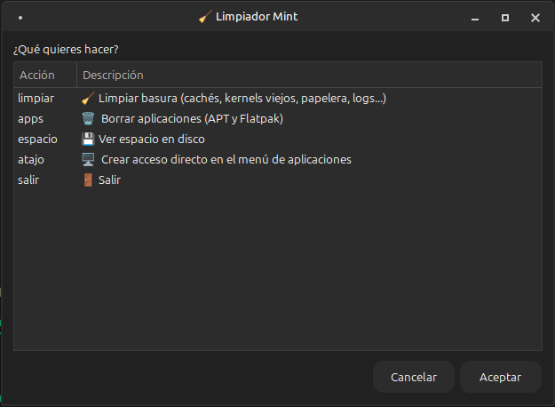
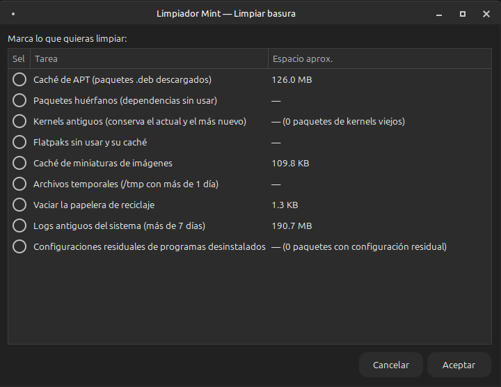
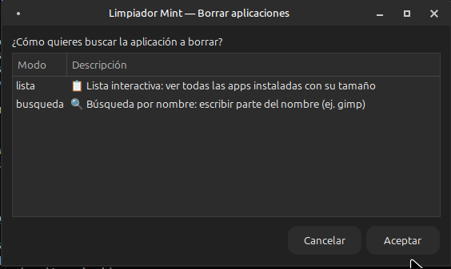
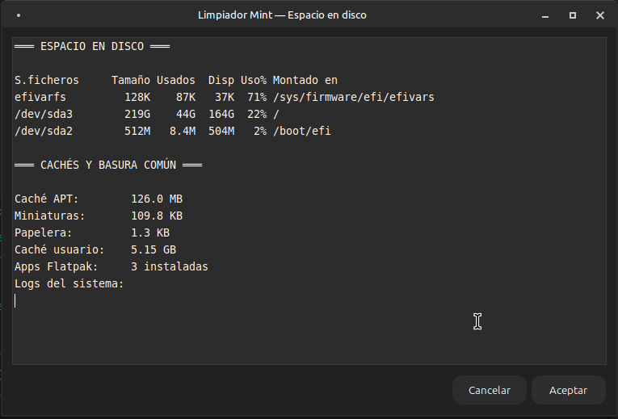

<div align="center">

# 🧹 Limpiador Mint

**Limpia la basura del sistema y desinstala aplicaciones en Linux Mint con una interfaz gráfica simple. Sin memorizar comandos.**

*A graphical cleaner for Linux Mint — clean system junk and uninstall apps easily. No commands to remember.*

[](./LICENSE)
[](../../releases)
[](https://linuxmint.com)
[](https://www.gnu.org/software/bash/)
[](https://wiki.gnome.org/Projects/Zenity)

</div>

<!-- 📸 CAPTURAS: coloca tus imágenes en docs/img/ y descomenta estas líneas:
|  |  |
|:---:|:---:|
|  |  |
-->

---

## 🇪🇸 Español

### ¿Qué hace?

Limpiador Mint automatiza todos esos comandos de mantenimiento que siempre tienes que buscar en internet (`apt autoremove`, `journalctl --vacuum-time`, `flatpak uninstall --unused`...) y los convierte en una ventana gráfica con casillas de verificación, tamaños estimados y confirmaciones.

### Funciones

| Categoría | Qué limpia |
|---|---|
| 🗃️ Caché de APT | Paquetes `.deb` descargados (`apt clean` + `autoclean`) |
| 📦 Paquetes huérfanos | Dependencias que ya nadie usa (`apt autoremove --purge`) |
| 🐧 Kernels antiguos | Kernels viejos — **conserva siempre el actual y el más nuevo** |
| 📱 Flatpaks sin usar | Runtimes huérfanos y cachés de Flatpak |
| 🖼️ Miniaturas | Caché de miniaturas de imágenes (`~/.cache/thumbnails`) |
| ⏱️ Temporales | Archivos de `/tmp` con más de 1 día |
| 🗑️ Papelera | Vacía la papelera de reciclaje |
| 📜 Logs del sistema | Registros de más de 7 días (`journalctl --vacuum-time=7d`) |
| ⚙️ Configuraciones residuales | Paquetes en estado `rc` (desinstalados pero con configuración) |

Además:

- **🗑️ Borrar aplicaciones** — desinstala apps de APT y Flatpak con *lista interactiva* (con tamaño en disco) o *búsqueda por nombre*. Al purgar, ofrece eliminar también las dependencias huérfanas.
- **💾 Ver espacio en disco** — resumen de uso de disco y cachés comunes.
- **🖥️ Acceso directo** — se instala en tu menú de aplicaciones con un clic.

### Seguridad

- ✅ Confirmación con resumen y espacio estimado **antes de cada acción destructiva**.
- ✅ Lista de paquetes protegidos: nunca ofrece borrar el kernel en uso, paquetes esenciales (`Essential: yes`) ni componentes clave de Mint/XFCE (`mint*`, `xfce4*`, `grub*`, `systemd`...).
- ✅ Los permisos de root se piden con el diálogo nativo de polkit (`pkexec`) — tu contraseña nunca pasa por una ventana de texto.
- ✅ Registro en `/tmp` de cada operación para poder revisarla.

### Requisitos

- Linux Mint (probado en **Mint 22.3 XFCE**; debería funcionar en Cinnamon/MATE y cualquier Ubuntu/Debian con zenity)
- `zenity` y `pkexec` — ya vienen instalados en Mint

### Instalación

```bash
git clone https://github.com/toxico80/Limpalor.git
cd Limpalor
chmod +x limpiador.sh
./limpiador.sh
```

Consejo: abre la herramienta y usa la opción **🖥️ Crear acceso directo** para tenerla en tu menú de aplicaciones.

### Uso desde terminal (sin ventanas)

```bash
./limpiador.sh --todo    # limpia TODAS las categorías (usa sudo)
./limpiador.sh --help    # ayuda
```

### Automatizar con cron (opcional)

```bash
sudo crontab -e
# Limpieza automática cada domingo a las 10:00:
0 10 * * 0 /ruta/a/herramienta_Linux/limpiador.sh --todo
```

---

## 🇬🇧 English

### What does it do?

Limpiador Mint (Mint Cleaner) automates all those maintenance commands you always have to look up online (`apt autoremove`, `journalctl --vacuum-time`, `flatpak uninstall --unused`...) and turns them into a simple GUI with checkboxes, estimated sizes and confirmations.

### Features

| Category | What it cleans |
|---|---|
| 🗃️ APT cache | Downloaded `.deb` packages (`apt clean` + `autoclean`) |
| 📦 Orphaned packages | Dependencies no longer needed (`apt autoremove --purge`) |
| 🐧 Old kernels | Old kernels — **always keeps the running one and the newest** |
| 📱 Unused Flatpaks | Orphaned runtimes and Flatpak caches |
| 🖼️ Thumbnails | Image thumbnail cache (`~/.cache/thumbnails`) |
| ⏱️ Temporary files | Files in `/tmp` older than 1 day |
| 🗑️ Trash | Empties the recycle bin |
| 📜 System logs | Journals older than 7 days (`journalctl --vacuum-time=7d`) |
| ⚙️ Residual configs | Packages in `rc` state (removed but config left behind) |

Also:

- **🗑️ Uninstall apps** — remove APT and Flatpak apps via an *interactive list* (with on-disk size) or *search by name*. After purging, it offers to remove leftover orphaned dependencies.
- **💾 Disk usage** — overview of disk space and common caches.
- **🖥️ Desktop shortcut** — installs itself into your application menu with one click.

### Safety

- ✅ Confirmation dialog with a summary and estimated freed space **before every destructive action**.
- ✅ Protected package list: it never offers to remove the running kernel, essential packages, or key Mint/XFCE components.
- ✅ Root privileges are requested through the native polkit dialog (`pkexec`) — your password never goes through a text window.
- ✅ Every operation is logged to `/tmp` so you can review it.

### Requirements

- Linux Mint (tested on **Mint 22.3 XFCE**; should work on Cinnamon/MATE and any Ubuntu/Debian with zenity)
- `zenity` and `pkexec` — already installed on Mint

### Installation

```bash
git clone https://github.com/toxico80/Limpalor.git
cd Limpalor
chmod +x limpiador.sh
./limpiador.sh
```

Tip: open the tool and use **🖥️ Create shortcut** to add it to your application menu.

### Terminal mode (headless)

```bash
./limpiador.sh --todo    # clean ALL categories (uses sudo)
./limpiador.sh --help    # help
```

---

<div align="center">

### 📁 Estructura del proyecto / Project structure

```
herramienta_Linux/
├── limpiador.sh        # Menú principal / Main menu (zenity)
├── lib/
│   ├── utilidades.sh   # Diálogos, espacio, protecciones / Dialogs & safety
│   ├── limpieza.sh     # 9 tareas de limpieza / 9 cleaning tasks
│   └── apps.sh         # Inventario y desinstalación / App inventory & removal
└── README.md
```

Hecho con ❤️ y Bash por [toxico80](https://github.com/toxico80) · Licencia MIT

*¿Te ayudó? ¡Dale una ⭐ al repo!* — *Found it useful? Give the repo a ⭐!*

</div>
